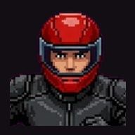
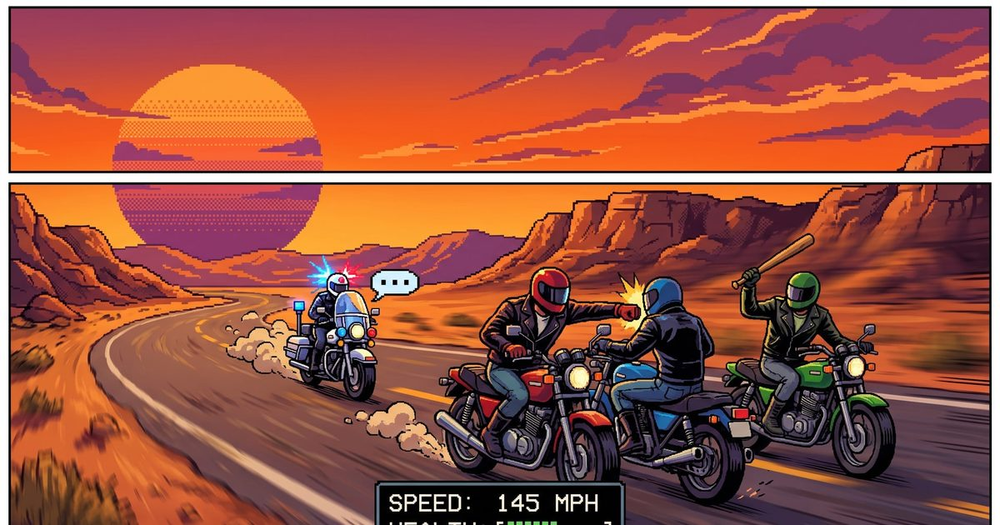

<a id="readme-top"></a>

[](https://github.com/sanketshinde3001/blacktop-brawl/actions/workflows/ci.yml)


[](LICENSE)

<div align="center">
  
  <h1>Blacktop Brawl</h1>
  <p>A motorcycle combat racer for the browser. Race, fight, upgrade, repeat.</p>
  <p><a href="#getting-started">Getting started</a> · <a href="#whats-in-the-game">Features</a> · <a href="#controls">Controls</a> · <a href="#launching">Hosting</a> · <a href="THIRD_PARTY_NOTICES.md">Credits and licenses</a></p>
</div>



A from-scratch motorcycle brawler in the style of the early-90s Mega Drive / Genesis
classics (Road Rash and friends), built with **TypeScript + Vite + Canvas2D + WebAudio**. The art was
generated with Google Gemini and a local Qwen-Image model; everything else
(sound effects, music, voices, missing animation frames) is made locally in code, so the game builds
and ships without any API credits.

## Getting started

Requires Node.js 22 or newer. No Gemini key, local AI model or backend is needed to play or build.

```bash
npm ci
npm run dev          # http://localhost:5173
```

## What's in the game

A complete career from the start grid to the championship, plus quick-play modes:

| Screen | What happens |
| --- | --- |
| Boot → Title | Loading bar, key art + chrome logo slam, "PRESS START". Idle 28 s → attract-mode demo race. |
| Main menu | New game, continue (autosave), endless run, daily challenge, 2 players, records, password, options, controls, credits. |
| Name entry | Pick your rider name, then **Easy / Normal / Hard**. |
| Level map | 5 roads per level: **Sierra Nevada, Pacific Coast, Redwood Forest, Palm Desert, Grass Valley**, each in day, dusk, night or rain depending on the level. Cash, bike, password. |
| Bike shop | 12 bikes (incl. the Mudcat dual-sport, Vandal cruiser and Apex turbo), stats, trade-in, plus a parts counter: engine, tyres, brakes, armour and nitro kit, three stages each. |
| Bar | A rival trash-talks you before every race. |
| Race | 15 riders, punches / kicks, clubs / chains / crowbars (steal them), nitro, crashes + running back to your bike, traffic both ways, cops, jumps over crests, working rear-view mirrors, chase / high / first-person (rider's-eye cockpit) cameras, look-behind, day / dusk / night / rain. |
| Result | Prize money, fines when **BUSTED**, repair bills when **WRECKED**, rival reactions. |
| Standings | Full finishing order + purses. |
| Level complete | Qualify (4th or better) on all five roads → next level: longer roads, faster rivals, more cops. |
| Game over | Can't pay a fine or a repair bill. |
| Champion | Beat level 5 → ending + credits. |
| Endless run | Stage after stage through all five roads and every condition; rivals speed up each stage, bike damage carries over, finish 4th or better to go on. Best score is saved. |
| Daily challenge | One race a day, same road / weather / bike for everyone, scored on time, place and knockouts. |
| 2 players | Split screen (top / bottom) on one keyboard or two gamepads, with or without the rival field. |
| Records | 20 achievements, scoreboards (this device, or online if set up, see `server/`), lifetime stats. |

## Controls

Right hand on the arrows, left hand resting on Q W E / A S D:

| Action | Keyboard | Gamepad |
| --- | --- | --- |
| Accelerate / brake / steer | ↑ / ↓ / ← → | A or RT / B or LT / D-pad, stick |
| Hit **left / right** (fist or weapon) | A / D | X / Y |
| Kick (nearest side) | S | LB / RB |
| Nitro boost | Space | Left stick click (L3) |
| Look behind (hold) | Q | Right stick click (R3) |
| Camera: chase → high → first person | E | Select / Back |
| Pause | Esc | Start |
| Debug overlay (dev build only) | \` (backquote) or F1 | |

The earlier keys (Z / X hit, C kick, N nitro, V camera) still work.

On phones and tablets the on-screen controls appear automatically (landscape only): D-pad with
LOOK above it for the left thumb; GAS with BRAKE, HIT L, HIT R, KICK and NOS around it for the right. Name and password entry use the device keyboard.

**2 players (split screen):** P1 = W A S D, Q / E hit, R kick, Left Shift nitro (or gamepad 1);
P2 = I J K L or the arrows, U / O hit, H kick, N or Right Shift nitro (or gamepad 2). Esc pauses.

Tips: hit an armed rival while they swing to snatch the weapon (chains reach furthest, crowbars hit
hardest). Crash near a cop and you're busted. Rain means less grip and weaker brakes: race tyres help.

## Project layout

```
src/
  config.ts            all feel/tuning constants (camera, physics, sizes, rules)
  main.ts              registers scenes, URL debug params
  engine/              Game loop + scene manager, Input, Assets, Audio, SynthMusic, math, Rng
  data/                bikes, riders (the 14 rivals), tracks, levels  ← most content lives here
  game/                Career, Password codec, runs (endless / daily), achievements, scoreboards, localStorage
  race/                the racing game itself
    Track.ts           seeded road builder (curves, hills, props, start/finish, cops)
    Racer.ts           bike + rider physics, jumps, crash tumbling
    AI.ts              rival and cop brains (traffic dodging, fighting, chasing, busting)
    Combat.ts          punches, kicks, clubs, weapon stealing
    Traffic.ts         civilian cars both directions
    Race.ts            simulation: collisions, finish, bust/wreck, standings, events
    Renderer.ts        pseudo-3D segment renderer + sprites + particles
    Hud.ts             speedo, tacho, mirror, health, progress
  scenes/              every screen (title, menus, shop, race, results, …)
  ui/                  drawing helpers + Menu widget
scripts/               Gemini asset pipeline, manifest builder, headless race simulator
tests/                 vitest: password, economy, track generation, race smoke tests
public/assets/         generated art + audio + manifest.json
```

The race simulation (`src/race/Race.ts`) has no DOM or rendering dependencies. It reports
everything through `race.events`, which `scenes/RaceScene.ts` turns into sounds, messages and particles.
That split is what makes the headless simulator and the tests possible.

## Debugging

- **URL jumps:** `?scene=race&track=desert&level=3`, `?scene=shop&money=50000`, `?scene=levels&level=4`,
  `?scene=race&track=pacific&demo=1` (AI drives). Add `&debug=1` for the overlay.
- **In a race with the debug overlay on:** `1` god mode, `2` skip ahead, `3` warp near the finish, `4` crash,
  `5` wreck, `6` sprite boxes, `7` give yourself a club. The overlay shows state plus a live event log.
- `window.__game` in the dev console exposes everything, e.g. `__game.scene.race.player`.
- **Headless balancing:** `npm run sim -- all 3 2` runs 2 races per track at level 3 with a human-like
  bot riding your bike (same controls + physics as you, with reaction delays) and prints where it
  finished, crash causes and fights. Add `--difficulty easy|hard`, or `--demo` to use the rival AI instead.
- **Camera:** the chase camera is a live object. In a race, try `__game.scene.cameraRig.fov = 70` or
  change `height`, `distance`, `horizon` from the console, then copy the values you like into `CAMERA` in
  `src/config.ts`.
- `npm test` runs the unit tests, smoke tests on every road and level, and a **full-career test** in
  which a bot plays the whole game from $1,000 on the starter bike to champion. `npm run typecheck` checks types.

## Asset pipeline (Gemini)

Put your key in `.env` (never shipped to the browser; only the Node scripts read it):

```bash
cp .env.example .env   # GEMINI_API_KEY=...
npm run assets:images  # sprites, backgrounds, portraits, bikes, UI art → public/assets/images
npm run assets:audio   # music (Lyria), jingles, sound effects, voices → public/assets/audio
```

| Kind | Model | Notes |
| --- | --- | --- |
| Sprites & art | `gemini-3.1-flash-image`, `gemini-3-pro-image` (logo, key art, text signs) | drawn on magenta, chroma-keyed + flood-filled to transparent WebP, trimmed |
| Rider poses | image **edits** of each rider's base frame | keeps the character identical across punch / kick / club frames |
| Backgrounds | 21:9, cross-faded to tile seamlessly | horizon auto-detected by `build-manifest` |
| Music | `lyria-3.5` (tracks), `lyria-3-clip-preview` (jingles) | |
| Sound effects | `gemini-omni-flash-preview` | returns a short clip; the strongest hit is extracted, loops cross-faded |
| Voices | `gemini-3.8-flash-tts` | |

Sound effects and voices are **auto-QA'd**: `gemini-3.5-flash` listens to each result and anything that
doesn't match its description is regenerated.

Everything is driven by the manifests in `scripts/assets/images.ts` and `scripts/assets/audio.ts`.
Raw model output is cached in `.asset-cache/`, so post-processing can be re-run for free:

```bash
npm run assets:images -- --only riders/punk      # regenerate one design (prefix match)
npm run assets:images -- --reprocess             # re-key / re-trim from cache, no API calls
npm run assets:sheet -- props sheet.png          # contact sheet to eyeball chroma keying
```

### Without Gemini credits

Everything the game still needed is produced locally, no API calls:

```bash
npm run assets:local
```

| Script | Makes |
| --- | --- |
| `scripts/derive-frames.ts` | Rival punch / kick / club and crash frames: the player's limb is cut out, recoloured to each rival's sleeve, trouser, helmet and bike colours, and baked onto the rival's riding frame. Listed in `images/derived.json`; real generated art is never overwritten. |
| `scripts/synth-sfx.ts` | All sound effects and jingles, rendered with plain DSP (noise, filters, oscillators). Synthesized locally. |
| `scripts/make-icons.ts` | Favicon, app icons. |
| `engine/SynthMusic.ts` | Music: a procedural rock band played live, one style per road. |
| `data/voices.ts` | Announcer / cop lines, spoken by the player's device (Web Speech API), with a generated Go clip supplied as well. |

If credits come back, `npm run assets:images` / `assets:audio` replace any of these with generated
versions; the game picks up whatever files exist. The bike engine is always synthesised live so its
pitch follows the tacho.

## Launching

```bash
npm run build        # -> dist/  (static files, relative paths, works from any folder or sub-path)
npm run package      # -> release.zip  (dist zipped, ready for itch.io)
```

- **itch.io:** new project, kind *HTML*, upload `release.zip`, tick *This file will be played in the
  browser*, viewport 1280 x 720, enable the fullscreen button and *mobile friendly* (landscape).
- **Netlify / Vercel / Cloudflare Pages / GitHub Pages:** publish the `dist/` folder as a static site
  (build command `npm run build`, output `dist`).
- Release builds have no debug overlay, cheat keys, URL scene jumps or `window.__game`.
- Races pause themselves when the tab is hidden; a crashed scene recovers to the title screen.
- **Online scoreboards (optional):** deploy `server/leaderboard-worker.js` (a free Cloudflare Worker,
  steps in `server/README.md`) and build with `VITE_LEADERBOARD_URL=<worker url> npm run package`.
  Without it the boards are kept per device and nothing is sent anywhere.
- **Name and trademarks.** The game is called *Blacktop Brawl* (`GAME_TITLE` in `src/config.ts`;
  the logo, page title, credits and announcer follow it, plus the two `name` fields in
  `public/manifest.webmanifest`). "Road Rash" is an Electronic Arts trademark, so it never appears as
  the game's name, logo or icon. It is only used descriptively for search ("Road Rash-style",
  "inspired by") in `index.html` (title, meta description, JSON-LD, screen-reader header), always
  with the disclaimer *"Not affiliated with or endorsed by Electronic Arts. Road Rash is a trademark
  of Electronic Arts Inc."*, which is also in the in-game credits. Keep store pages (itch.io etc.)
  the same way: own name in the title, "Road Rash-inspired" in the description and tags, and the
  disclaimer at the bottom. No extracted EA assets are included. See [asset provenance and licenses](THIRD_PARTY_NOTICES.md).

## Extending

- **New track:** add an entry to `src/data/tracks.ts` (colours, curve/hill style, props), add its
  props and background to `scripts/assets/images.ts`, then run `npm run assets:images`.
- **New bike:** append to `BIKES` in `src/data/bikes.ts` (append only: passwords store the index;
  the shop sorts by price) and add its art (`bikeEdit` in `scripts/assets/images.ts`, render with
  `npx tsx scripts/qwen-frames.ts --ids bikes/<id>`).
- **New weapon:** add it to `ATTACKS` in `src/race/Racer.ts`; rival swing frames are made from the
  club frames at load time (`Assets.weaponFrame`), the cockpit draws its own version.
- **Conditions:** `src/data/weather.ts` (palettes, grip, darkness, the career schedule).
- **Achievements:** `src/game/Achievements.ts` (listens to `game.events`).
- **New rival:** add to `src/data/riders.ts` (reuse a sprite `design` with a `hue` shift, or add a new design).
- **Balance:** `src/config.ts` (camera, steering response, curve pull, off-road limits),
  `src/data/levels.ts` (rival speeds, cops, traffic, prizes, difficulty presets), then `npm run sim`.
  At *normal* the bot qualifies in roughly 7-10 of 10 races per level; *hard* is a real fight.
- **New screen:** subclass `Scene`, register it in `main.ts`, switch with `game.go('name', params)`.

## Privacy

The default build has no ads, analytics or account login. Saves and personal records
stay in browser storage. Speech synthesis depends on the browser and selected
voice, which may use a network service. If an online scoreboard URL is configured,
posting a result sends the rider name, score and stage to that server; its hosting
provider also receives normal connection metadata.

## Limitations

- Pseudo-3D road rendering with sprite riders, not a fully 3D simulation.
- Automated tests cover simulation and progression; browser, phone and gamepad
  behaviour still benefits from real-device testing.
- Daily challenges share a route and loadout, but traffic and AI are not fully deterministic.
- Online scores are client-submitted, casual and not cheat-proof. The optional KV
  backend is intended for a small hobby audience, not competitive rankings.
- Game progress is stored in the browser. Clearing site data removes local saves;
  passwords preserve career progression and upgrades.

## License and credits

Code: [MIT](LICENSE). Fonts: SIL OFL 1.1. Generated asset provenance, bundled audio
and trademark notices: [THIRD_PARTY_NOTICES.md](THIRD_PARTY_NOTICES.md).

This is an independent hobby project. Referencing its inspiration does not imply
EA affiliation or legal clearance.

[Back to top](#readme-top)
